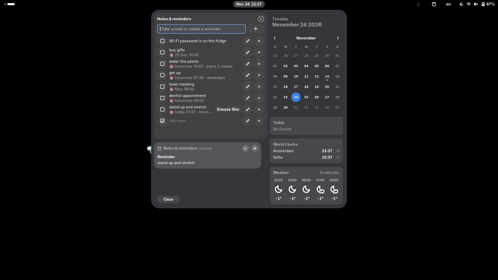

# Notes & Reminders in Clock Menu

A GNOME Shell extension that adds a notes and reminders list to the dropdown that opens when you click the clock. Type a note, or start it with a time and it becomes a reminder that pops up as a normal GNOME notification.

<!-- Add a screenshot here:  -->

## Features

- **Notes and reminders in one box.** Type, press Enter, done. No dialogs, no extra windows.
- **Flexible times.** `14:30`, `+10m`, `in 2 days`, `tomorrow 9am`, `mon 9:00`, `2026-12-25 10:00`, `dec 25`, and more.
- **Repeating reminders.** Daily, weekdays, weekly, monthly, yearly, every N hours/days/weeks, or every Monday.
- **Snooze.** Snooze 10 minutes from the notification or from the list.
- **Edit anything.** Change the text, time or repeat of an existing item.
- **Doesn't forget.** Reminders that came due while you were logged out or suspended show up as "Missed reminder" when you are back.
- **Works while the screen is locked.** Reminders keep firing on the lock screen.
- **Built-in help.** Click the **i** button next to the title.
- **Your data stays local.** Everything is stored in one JSON file on your computer.

## Requirements

GNOME Shell **46, 47, 48, 49, 50 or 51**.

> GNOME 45 is not supported because the notification API it uses changed in 46.

Tested on: GNOME Shell _(fill in your version)_.

## Installation

### Manual

1. Download or clone this repository.
2. Copy `extension.js`, `logic.js` and `metadata.json` into:

   ```
   ~/.local/share/gnome-shell/extensions/notes-reminders-menu@kalalinux/
   ```

   For example:

   ```bash
   git clone https://github.com/kaloyanMilev13/notes-reminders-menu.git
   mkdir -p ~/.local/share/gnome-shell/extensions/notes-reminders-menu@kalalinux
   cp notes-reminders-menu/{extension.js,logic.js,metadata.json} \
      ~/.local/share/gnome-shell/extensions/notes-reminders-menu@kalalinux/
   ```

   The folder name must be exactly `notes-reminders-menu@kalalinux`.

3. Restart GNOME Shell so it notices the new extension:
   - **Wayland:** log out and log back in.
   - **X11:** press <kbd>Alt</kbd>+<kbd>F2</kbd>, type `r`, press <kbd>Enter</kbd>.
4. Enable it:

   ```bash
   gnome-extensions enable notes-reminders-menu@kalalinux
   ```

   or switch it on in the Extensions app.

### Troubleshooting

Watch the Shell log while enabling the extension:

```bash
journalctl -f -o cat /usr/bin/gnome-shell
```

Lines from this extension start with `notes-reminders-menu`.

## Usage

Click the clock in the top bar. The notes box is at the top of the menu, next to the calendar.

Type something and press **Enter** (or click **+**). If the text does not start with a time or date, it is saved as a plain note.

### Reminders

Put the time at the **start** of the text:

| You type | What happens |
|---|---|
| `14:30 call Anna` | Next time it is 14:30 (today, or tomorrow if it has passed) |
| `9am take medicine` / `2:30pm x` | 12-hour times work too |
| `+10m tea is ready` | In 10 minutes (`+2h`, `+3d`, `+1w` also work) |
| `in 2 days renew passport` | In 2 days, at the current time |
| `tomorrow 9:00 dentist` | Tomorrow at 9:00 (if you leave out the time, 9:00 is used) |
| `today 18:00 groceries` | Today at 18:00 |
| `mon 9:00 team meeting` / `on friday 18:30 x` | The next Monday / Friday |
| `2026-12-25 10:00 gifts` | An exact date |
| `25/12 10:00 gifts` | Day/month, with an optional year: `25/12/2026` |
| `dec 25 10:00 gifts` / `25 december 2027 x` | Month names |

If the time you type has already passed, you get an error instead of a surprise. (Exception: a bare clock time like `14:30` rolls over to tomorrow.)

### Repeating reminders

| You type | What happens |
|---|---|
| `daily 8:00 pills` | Every day at 8:00 |
| `weekdays 7:30 get up` | Monday to Friday |
| `weekly`, `monthly`, `yearly`, `hourly` | Every week / month / year / hour |
| `every mon 9:00 gym` | Every Monday at 9:00 |
| `every 2 weeks 9:00 water plants` | Every two weeks |
| `every other day x` | Every second day |
| `every 3h stretch` | Every three hours |

Without a time, `daily` and `weekdays` start at 9:00 and `every 3h` starts 3 hours from now.

### When a reminder is due

A notification appears with **Snooze 10 min** (and **Done** for one-time reminders). A repeating reminder moves on to its next time on its own. If one or more repeats were missed, only the next future one is scheduled.

### Managing items

- **Checkbox:** mark as done (done items move to the bottom).
- **Pencil:** edit text, time and repeat, then press **Enter** to save or **Esc** to cancel.
- **✕:** delete.
- **Snooze button:** shown on a reminder that has already gone off.

### Plain notes that look like reminders

A bare date or weekday like `mon` or `1/2` is only a reminder if you also give a clock time, so notes like `1/2 cup flour` stay notes. To force a plain note, start with a backslash:

```
\tomorrow is just a word here
```

## Where is my data?

```
~/.local/share/notes-reminders-menu.json
```

It lives outside the extension folder, so updating or reinstalling the extension never touches your notes. Back it up by copying that file. To remove everything, delete it.

## Limitations

- Reminders only fire while GNOME Shell is running (logged in or on the lock screen). Anything that came due while you were logged out or the computer was off fires as a "Missed reminder" when the extension starts again.
- Times use your computer's local time zone and are accurate to the minute for reminders you type with a clock time.
- A monthly reminder set for the 31st moves to the 28th/30th after a shorter month and stays there.
- The extension has to rearrange the clock menu to make room for itself. If a future GNOME version changes that menu a lot, it falls back to placing the notes below the menu instead of beside it.
- The extension is in English only.

## Uninstall

```bash
gnome-extensions disable notes-reminders-menu@kalalinux
rm -r ~/.local/share/gnome-shell/extensions/notes-reminders-menu@kalalinux
```

Your notes file is kept unless you delete it too.

## How it is built

| File | What it does |
|---|---|
| `extension.js` | The GNOME Shell part: the menu UI, notifications, the reminder timer, saving and loading |
| `logic.js` | Pure JavaScript with no GNOME dependencies: parsing what you type, repeat rules, date formatting. Easy to test with plain Node. |
| `metadata.json` | Extension name, UUID and supported GNOME versions |

## AI disclosure

This extension was written with the help of [Claude](https://claude.ai) (Anthropic). The code is open so you can read and judge it for yourself.

## Contributing

Bug reports and pull requests are welcome. When you report a problem, please include your GNOME Shell version (`gnome-shell --version`) and any lines from `journalctl -f -o cat /usr/bin/gnome-shell` that start with `notes-reminders-menu`.

## License

GPL-3.0-or-later. See the [LICENSE](LICENSE) file.
